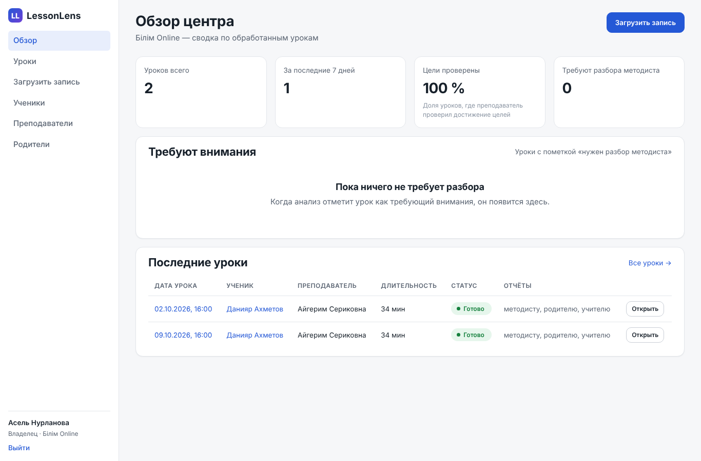
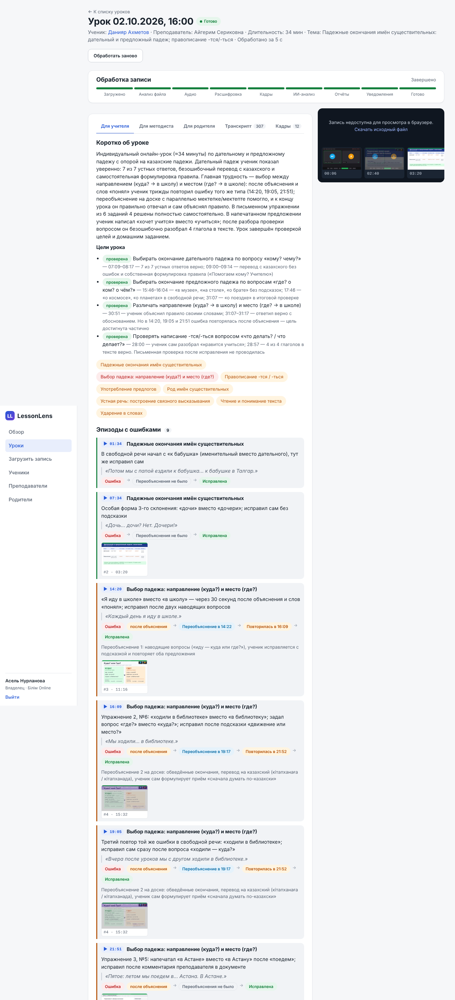
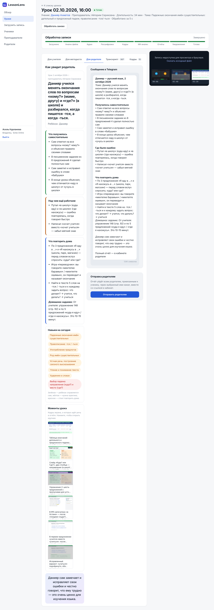
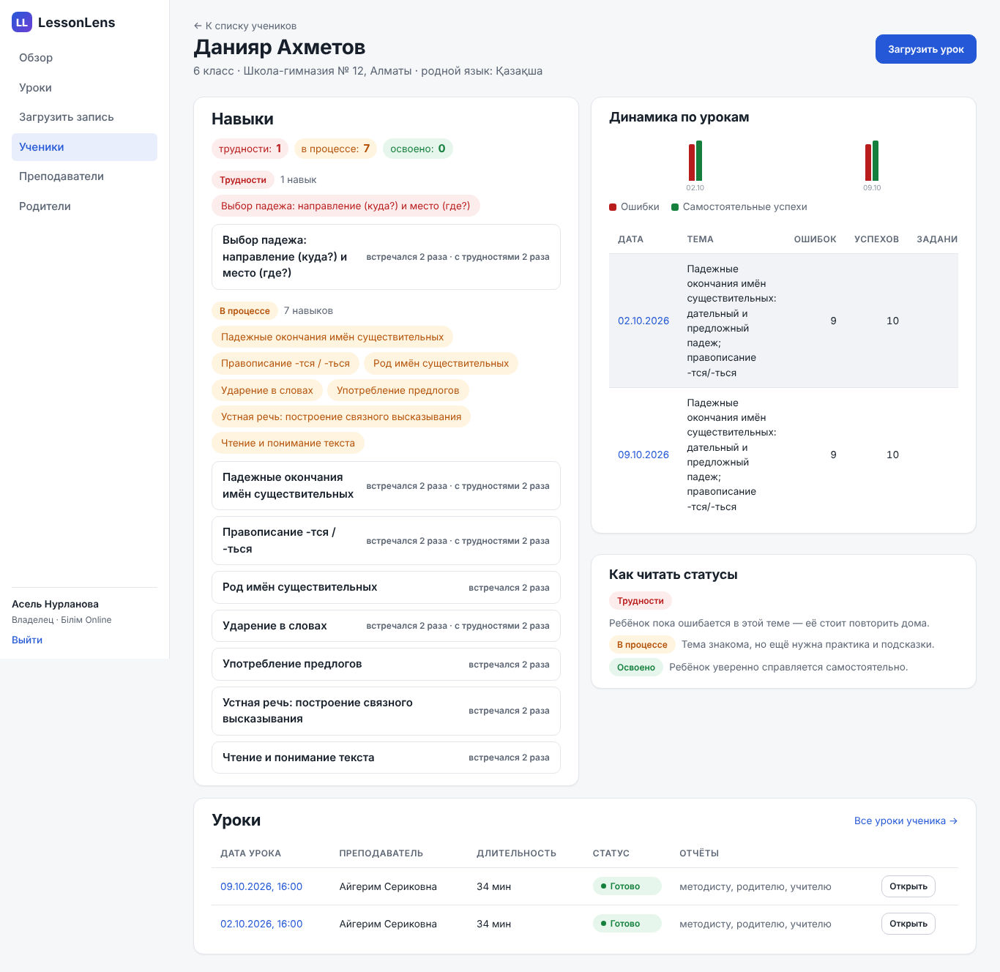
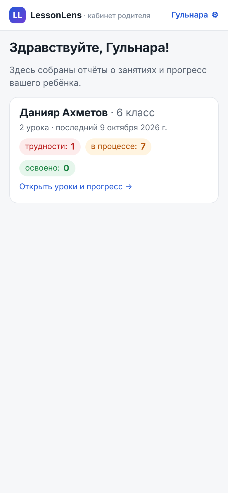
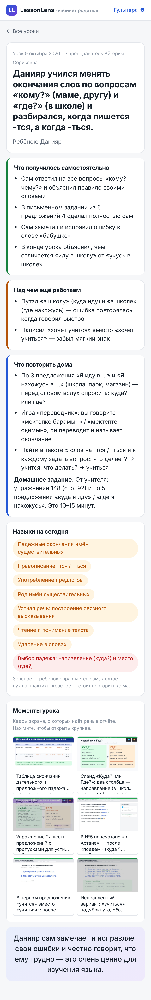
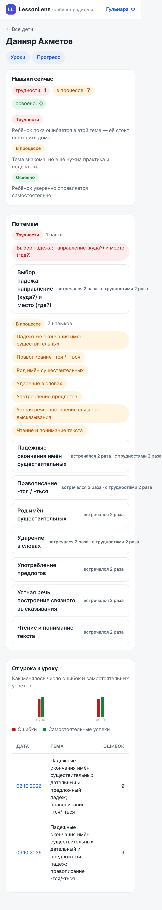

# LessonLens — AI-аналитика качества онлайн-уроков

**LessonLens** — сервис «post-lesson intelligence» для онлайн-репетиторских центров Казахстана. Центр загружает
запись урока (Zoom/Meet, видео или аудио), а система сама извлекает аудио и ключевые кадры экрана, расшифровывает речь
с разделением «учитель / ученик», отдаёт транскрипт вместе с кадрами мультимодальной LLM и получает строго
типизированный анализ урока: что объясняли, где ученик ошибся, повторилась ли ошибка после переобъяснения, что
ученик сделал самостоятельно, что было видно на доске и в тетради, какие пробелы в понимании просматриваются.

Из одного анализа собираются три отчёта: **преподавателю** (эпизоды с таймкодами и формулировки вопросов ученику),
**методисту/руководителю** (индикаторы качества без рейтинга учителя) и **родителю** (простым языком, что получилось,
что повторить дома; уходит в Telegram и в мобильный кабинет родителя). История уроков ученика накапливается в
прогрессе по навыкам с честным принципом «тему прошли ≠ тему усвоили». Пилотный сценарий — уроки русского языка в
казахской школе, формат «один преподаватель — один ученик», билингвальная речь ru/kk.

> Статус: **MVP версии 1** — весь контур работает локально end-to-end на mock-провайдерах STT/LLM/мессенджеров.
> Реальные адаптеры (Whisper, OpenAI, Deepgram, AssemblyAI, Google, ElevenLabs, Yandex; Anthropic, OpenAI; Telegram,
> WhatsApp) реализованы, но в этой среде вживую не проверялись — см. [Ограничения](#ограничения-текущей-версии).

## Скриншоты

| Обзор центра | Урок — вкладка «Для учителя» |
|---|---|
|  |  |

| Урок — вкладка «Для родителя» (+ превью Telegram) | Прогресс ученика |
|---|---|
|  |  |

| Кабинет родителя (390×844) | Отчёт по уроку | Прогресс ребёнка |
|---|---|---|
|  |  |  |

Скриншоты сделаны автоматически e2e-тестом (`backend/tests/e2e/test_smoke.py`) на демо-данных.

## Быстрый старт (локально, mock-провайдеры)

Требования: Python 3.13, Node 22, PostgreSQL 16, ffmpeg/ffprobe.

```bash
# 1. PostgreSQL: пользователь/пароль lessonlens, базы lessonlens (dev) и lessonlens_test (тесты)
make db-up                                   # pg_ctlcluster 16 main start
sudo -u postgres psql -c "CREATE USER lessonlens PASSWORD 'lessonlens';" \
                     -c "CREATE DATABASE lessonlens OWNER lessonlens;" \
                     -c "CREATE DATABASE lessonlens_test OWNER lessonlens;"

# 2. Backend
cd backend
python3 -m venv .venv && .venv/bin/pip install -r requirements.txt
cp ../.env.example ../.env                   # по умолчанию STT_PROVIDER=mock, LLM_PROVIDER=mock
.venv/bin/alembic upgrade head

# 3. Демо-данные: центр, 3 сотрудника, учитель, ученик, родитель и два обработанных урока
.venv/bin/python -m app.seed_demo --reset    # ≈10 с, печатает логины и magic-ссылку родителя

# 4. API и фронтенд (две консоли)
.venv/bin/uvicorn app.main:app --reload --port 8000     # http://localhost:8000/api/docs
cd ../frontend && npm install && npm run dev            # http://localhost:5173
```

То же самое через `make`: `make migrate seed-reset`, затем `make api` и `make web` в двух консолях
(`make help` — список целей).

### Демо-входы

| Роль | Логин | Пароль |
|---|---|---|
| владелец центра | `admin@demo.kz` | `demo12345` |
| методист | `methodist@demo.kz` | `demo12345` |
| преподаватель (видит только свои уроки, без вкладки «Для методиста») | `teacher@demo.kz` | `demo12345` |

Демо-центр «Білім Online», преподаватель Айгерим Сериковна, ученик Данияр Ахметов (6 класс), мама Гульнара Ахметова
(код приглашения `DEMO2026`). Оба урока — один и тот же демонстрационный сценарий (падежные окончания, -тся/-ться),
поэтому в прогрессе каждый навык «встречался 2 раза».

### Демо-поток родителя

1. Войдите как `admin@demo.kz` → **Родители** → «Создать magic-ссылку» (или возьмите ссылку из вывода сидирования).
2. Откройте ссылку `http://localhost:5173/p/<token>` в окне шириной с телефон — кабинет родителя: ребёнок → уроки →
   отчёт по уроку (тема простыми словами, что получилось, что повторить дома, кадры-«моменты урока») → вкладка
   «Прогресс» (навыки по статусам и динамика от урока к уроку). Ссылка действует 72 ч и открывается повторно;
   администратор может отозвать доступ родителя кнопкой «Отозвать доступ» (ссылки, вход и Telegram перестают работать).
3. На странице урока вкладка **«Для родителя»** показывает отчёт глазами родителя, превью Telegram-сообщения и кнопку
   «Отправить родителям». Без токена бота отправка записывается в `notifications` со статусом `skipped`
   («Родитель ещё не открыл Telegram-бот»). Как подключить настоящего бота — в [docs/MESSAGING.md](docs/MESSAGING.md)
   и [docs/DEMO.md](docs/DEMO.md).

Загрузка своей записи: **Загрузить запись** → файл (mp4/mkv/webm/mov/m4a/mp3/wav…), ученик, преподаватель, дата,
обязательная галочка согласия законного представителя. Статус обработки обновляется на странице урока
(`uploaded → probing → extracting_audio → transcribing → extracting_frames → analyzing → reporting → notifying → done`).

## Конфигурация провайдеров (`.env`)

Единственный список переменных — [`.env.example`](.env.example). Главное:

| Переменная | Значения | Комментарий |
|---|---|---|
| `STT_PROVIDER` | `mock` \| `whisper_local` \| `openai` \| `deepgram` \| `assemblyai` \| `google` \| `elevenlabs` \| `yandex` | ключи: `OPENAI_API_KEY`, `DEEPGRAM_API_KEY`, `ASSEMBLYAI_API_KEY`, `GOOGLE_APPLICATION_CREDENTIALS`, `ELEVENLABS_API_KEY`, `YANDEX_API_KEY`+`YANDEX_FOLDER_ID`; `WHISPER_MODEL` для локального Whisper (рекомендация бенчмарка — `large-v3-turbo`) |
| `LLM_PROVIDER` | `mock` \| `anthropic` \| `openai` | `ANTHROPIC_API_KEY`, `LLM_MODEL` (по умолчанию `claude-sonnet-5-5`), `LLM_MAX_FRAMES`, `LLM_EFFORT`; для OpenAI — `OPENAI_LLM_MODEL` |
| `TELEGRAM_BOT_TOKEN`, `TELEGRAM_MODE` | токен @BotFather; `polling` \| `webhook` | пусто = бот выключен; webhook: `TELEGRAM_WEBHOOK_URL` + `TELEGRAM_WEBHOOK_SECRET` |
| `WHATSAPP_ENABLED` … | Meta Cloud API | заготовка: free-form сообщения, шаблоны не реализованы |
| `MESSAGING_PROVIDER=mock` | | все сообщения в память — для тестов и сидирования |
| `PIPELINE_MODE` | `inline` \| `worker` | `inline` — обработка фоновой задачей в API-процессе (демо); `worker` — очередь в таблице `jobs`, отдельный процесс `python -m app.worker` |
| `KEYFRAME_INTERVAL_SEC`, `KEYFRAME_SCENE_THRESHOLD`, `KEYFRAME_MAX`, `KEYFRAME_SCAN_MAX_GAP_SEC` | | быстрый поиск ключевых кадров (см. `docs/PERFORMANCE.md`) |
| `WHISPER_DEVICE`, `WHISPER_BEAM_SIZE`, `WHISPER_BATCH_SIZE`, `WHISPER_CPU_THREADS` | | скорость локального Whisper |
| `WORKER_CONCURRENCY`, `PIPELINE_HEARTBEAT_SEC` | | параллельная обработка уроков, статус долгих этапов |
| `PUBLIC_BASE_URL` | адрес фронтенда | из него собираются magic-ссылки `…/p/<token>` |

Сравнение STT-провайдеров по WER/CER для ru/kk/смешанной речи, цены и рекомендация для пилота —
[docs/PROVIDERS.md](docs/PROVIDERS.md); бенчмарк воспроизводится из `backend/benchmarks/`.

**Telegram.** Создайте бота у @BotFather, укажите `TELEGRAM_BOT_TOKEN` и `TELEGRAM_MODE=polling`, перезапустите API.
Родитель открывает deep-link `https://t.me/<bot>?start=<invite_code>` (кнопка «Отправить приглашение» в разделе
«Родители»), бот привязывает chat_id, после чего отчёты уходят автоматически после каждого урока. Подробности, команды
бота (`/start`, `/progress`, `/help`, `/stop`) и режим webhook — [docs/MESSAGING.md](docs/MESSAGING.md).

## Docker (best-effort)

`docker-compose.yml` поднимает `postgres` + `api` (alembic upgrade + uvicorn) + `worker` (`PIPELINE_MODE=worker`) +
`frontend` (Vite dev server с прокси `/api → api:8000`):

```bash
cp .env.example .env            # и замените SECRET_KEY: без него api/worker не стартуют (${SECRET_KEY:?})
docker compose up --build
docker compose run --rm api python -m app.seed_demo --reset
```

PostgreSQL публикуется только на `127.0.0.1:5432`; пароль задаётся переменной `POSTGRES_PASSWORD` (по умолчанию
`lessonlens` — только для локального стенда). В `APP_ENV=prod` API отказывается запускаться с SECRET_KEY-заглушкой или
ключом короче 32 символов.

Образы описаны в `backend/Dockerfile` (python 3.13-slim + ffmpeg) и `frontend/Dockerfile` (node 22). **В среде, где
собирался MVP, Docker-демон был недоступен, поэтому compose и Dockerfile написаны, но не запускались** — считайте их
стартовой точкой, а не проверенной поставкой.

## Тесты

```bash
make test            # backend: pytest против Postgres lessonlens_test (148 тестов) + frontend: vitest (33 теста)
make lint            # ruff (backend) + tsc --noEmit (frontend)

# Browser-smoke (Playwright, Chromium). Нужны засиженная dev-БД и запущенные API (:8000) и Vite (:5173):
cd backend && E2E=1 PLAYWRIGHT_BROWSERS_PATH=/opt/pw-browsers .venv/bin/python -m pytest tests/e2e -q
# или make e2e. Без E2E=1 тест пропускается. Если браузеры не предустановлены: .venv/bin/playwright install chromium
```

E2E проходит путь «вход сотрудника → дашборд → список уроков → вкладки отчётов и кадры → прогресс ученика →
magic-ссылка → кабинет родителя на мобильном viewport» и обновляет скриншоты в `docs/screenshots/`.

## Карта репозитория

```
backend/
  app/
    main.py, config.py, logging.py       FastAPI, настройки (pydantic-settings), structlog
    db/models.py                         все ORM-модели (единственное место схемы)
    migrations/                          alembic (одна линейная ревизия)
    schemas/analysis.py                  LessonAnalysis — контракт ответа LLM
    schemas/api.py                       DTO API
    api/                                 auth, centers (+dashboard), people, lessons, reports, progress, parent, media, telegram, health
    pipeline/                            runner (стадии и статусы), media (ffmpeg/ffprobe/dHash), analysis (промпт → LLM → валидация),
                                         reports (3 отчёта + Telegram HTML), progress (skill_states), jobs (очередь), prompts/
    providers/stt|llm|messaging/         протоколы + адаптеры + mock + registry
    bot/telegram.py                      aiogram 3: /start <code>, /progress, /help, /stop
    services/                            auth (JWT, magic-ссылки), storage (MEDIA_ROOT), notifications, audit
    seed_demo.py, worker.py              демо-сид, воркер очереди
  tests/                                 pytest (API, пайплайн, анализ, отчёты, прогресс, уведомления, бот) + tests/e2e (Playwright)
  benchmarks/                            STT-бенчмарк ru/kk/mixed (синтетический датасет, результаты)
frontend/                                React 18 + Vite + TypeScript: кабинет центра и мобильный кабинет родителя
demo/                                    фикстуры демо-урока: сценарий, транскрипт, кадры, готовый анализ, генератор lesson.mp4
docs/                                    документация (ниже)
docker-compose.yml, Makefile, .env.example
```

## Документация

| Файл | О чём |
|---|---|
| [docs/CONTRACT.md](docs/CONTRACT.md) | технический контракт: архитектура, схема БД, API, правила отчётов, конвенции |
| [docs/ARCHITECTURE.md](docs/ARCHITECTURE.md) | обзор системы, пайплайн, где лежат персональные данные, деплой, дорожная карта |
| [docs/DEMO.md](docs/DEMO.md) | сценарий демонстрации: что кликать, демо-поток родителя, troubleshooting |
| [docs/PROVIDERS.md](docs/PROVIDERS.md) | STT/LLM-провайдеры: бенчмарк WER/CER ru/kk, цены, рекомендация для пилота |
| [docs/PERFORMANCE.md](docs/PERFORMANCE.md) | скорость обработки: замеры до/после на 45-минутной записи 1080p, где теперь время |
| [docs/MESSAGING.md](docs/MESSAGING.md) | Telegram-бот, WhatsApp-заготовка, уведомления |
| [docs/FRONTEND.md](docs/FRONTEND.md) | структура фронтенда, маршруты, состояния |
| [docs/LEGAL_KZ.md](docs/LEGAL_KZ.md) | персональные данные детей по законодательству РК, роли, чек-лист пилота (не юридическая консультация) |
| [docs/CONSENT_TEMPLATE.md](docs/CONSENT_TEMPLATE.md) | шаблоны согласий родителя и преподавателя, текст чекбокса согласия |

## Ограничения текущей версии

- **Реальные провайдеры не проверены вживую.** Все STT/LLM/мессенджер-адаптеры написаны по документации API и
  покрыты тестами со стабами, но в среде разработки не было ключей; первое включение `STT_PROVIDER`/`LLM_PROVIDER` ≠
  `mock` потребует проверки форм ответов. Бенчмарк STT выполнен на синтетической TTS-речи — это верхняя граница.
- **Демо — mock-данные.** Оба демо-урока используют одну и ту же фикстуру транскрипта/анализа. Видео по умолчанию —
  сжатая 90-секундная заглушка: сидирование выставляет кадрам и уроку таймкоды из `demo/lesson_01/frames/frames.json`
  (клик по таймкоду отчёта подсвечивает нужный кадр), но сам плеер показывает 90-секундный ролик, поэтому позиция
  видео не совпадает с таймкодом. Для полной синхронизации: `python -m app.seed_demo --reset --realtime` (видео 35 мин,
  ≈10 МБ).
- **Ограничение прав по ролям.** Лимиты частоты запросов (вход, регистрация центра, обмен magic-ссылки) и
  счётчик неверных кодов в боте хранятся в памяти процесса — при нескольких экземплярах API нужен лимитер на прокси.
- **Нет интеграции с Zoom/Meet** — запись загружается вручную; realtime-подсказок и авто-подключения бота нет.
- WhatsApp — только free-form сообщения (шаблоны Meta не реализованы); тексты бота и уведомлений только на русском.
- Код-свитчинг ru↔kk внутри одной фразы Whisper не решает (WER ≈ 57 % на смешанных клипах) — см. PROVIDERS.md.
- Политика хранения/удаления записей, экспорт данных и маркировка «сгенерировано ИИ» описаны в LEGAL_KZ.md §9.2, но
  в коде пока не реализованы.
- Docker-файлы не запускались (нет демона в среде сборки).

## Дорожная карта

1. **Пилот (v1.x)** — подключение реального STT (рекомендация: `whisper_local` large-v3-turbo + A/B с Deepgram Nova-3 /
   ElevenLabs Scribe) и Anthropic Claude; DPA и согласия по LEGAL_KZ.md; задание на удаление/ретеншн записей;
   маркировка ИИ-контента в отчётах; второй демо-урок с другой фикстурой.
2. **v2 — Live copilot** — подключение к Zoom RTMS/Meet, подсказки преподавателю во время урока, авто-загрузка записей.
3. **v3 — Learning intelligence** — межурочная аналитика по центру, групповые занятия, другие предметы и языки
   обучения, сравнение методик без рейтингов преподавателей.
